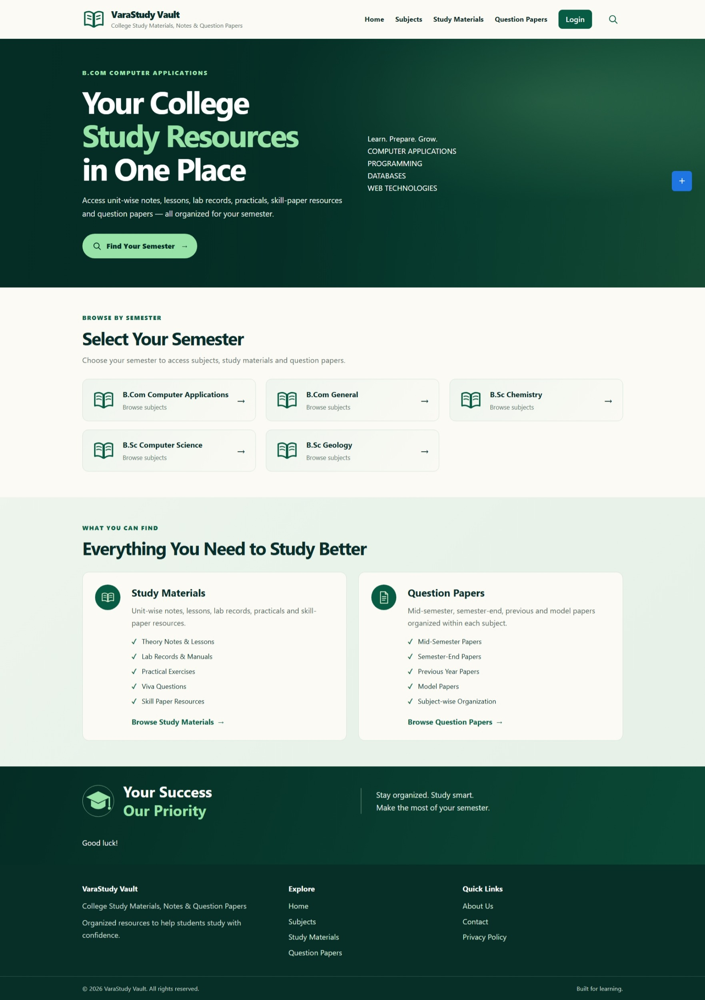
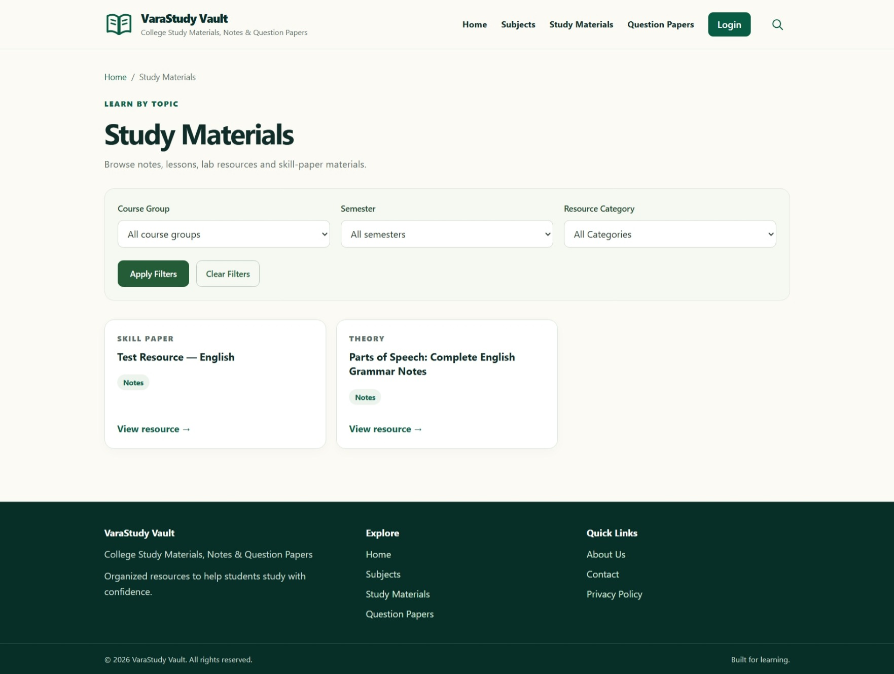

# VaraStudy Vault

  

  <strong>Study · Learn · Grow</strong>
   
  An independent classic WordPress theme for organizing college study resources.

---

## Screenshots

### Homepage

Explore semester-based navigation, study materials, and question papers in one place.

### Study Materials Archive

Browse resources using course group, semester, and resource category filters.

---

## Features

- Subject, study-material, and question-paper archive templates
- Resource cards and breadcrumb navigation
- Semester and subject-based resource navigation
- Primary and footer menu locations
- Responsive layout and keyboard-visible focus styles
- Support for WordPress custom post types and Advanced Custom Fields (ACF)

## Requirements

- WordPress 6.0 or later
- PHP 7.4 or later
- Custom post types registered with these slugs:
  - `subjects`
  - `study-materials`
  - `question-papers`
- Advanced Custom Fields (ACF), configured with the fields listed below

**Important:** This theme does not register custom post types or ACF fields. Keep your existing CPT UI (or equivalent registration setup) and ACF configuration active.

## Expected ACF Fields

`semester`, `subject_code`, `subject_description`, `subject`, `resource_category`, `unit_lesson`, `theory_resource_type`, `lab_resource_type`, `skill_resource_type`, `pdf_file`, `resource_link`, `exam_type`, `paper_status`, `academic_year`, `question_paper_pdf`.

The `subject` relationship/post-object field must return a value format supported by the theme. Check its return format in ACF and test resource-to-subject navigation on a development site.

## Installation

1. Back up your site and test the theme on a development or staging site first.
2. Open **Appearance → Themes → Add New → Upload Theme** in WordPress.
3. Upload the theme ZIP from the [Releases](https://github.com/Varaprasad-Jada/varastudy-vault/releases) page, or install the theme folder from this repository.
4. Activate **VaraStudy Vault**.
5. Keep the required custom post type and ACF configurations enabled.
6. Open **Settings → Permalinks** and click **Save Changes** once.
7. Assign your menus under **Appearance → Menus**, according to your WordPress setup.
8. Create the About, Contact, and Privacy Policy pages if needed, and review the links in `footer.php`.

## Development Notes

- Theme stylesheet: `style.css`
- Theme setup and resource helpers: `functions.php`
- Navigation script: `assets/js/navigation.js`
- Internal CSS classes retain the `cv-` prefix.
- Theme name: VaraStudy Vault
- Text domain: `varastudy-vault`

The theme is used on the developer's own website. Compatibility has not been verified against every WordPress, CPT UI, or ACF configuration. Test archive filters, relationship fields, menus, and resource links before deploying to another production site.

## Images and Branding

The theme does not bundle stock photography or user-specific branding images. Site owners can configure their own site icon, logo, images, and study-resource content using WordPress and the theme's supported features.

Users are responsible for ensuring they have permission to use the content they upload.

## License

VaraStudy Vault is distributed under the **GNU General Public License, version 2 or later (GPL-2.0-or-later)**.

See the [`LICENSE`](LICENSE) file for the complete license text.

---

  <strong>VaraStudy Vault</strong>
   
  An independent open-source WordPress theme.
   
  <a href="https://github.com/Varaprasad-Jada/varastudy-vault">View repository</a>
  ·
  <a href="https://github.com/Varaprasad-Jada/varastudy-vault/releases">View releases</a>

